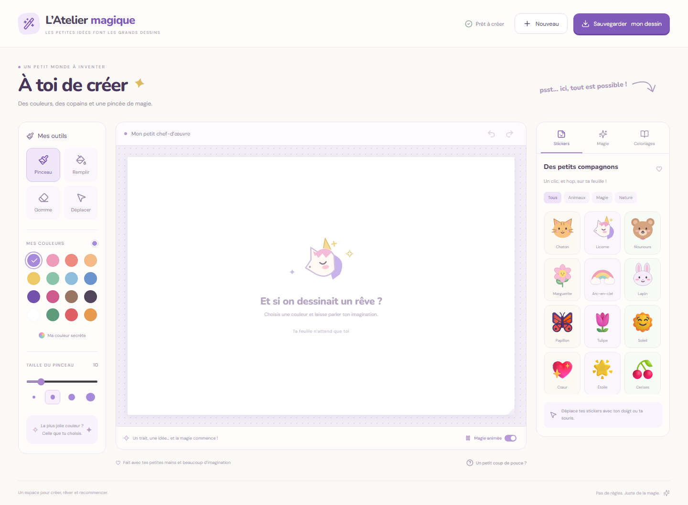

# L’Atelier magique

Jeu de dessin React en français, utilisable à la souris, au stylet ou au doigt.

## Démarrer

Installer Node.js 20.19+ ou 22.12+, puis dans ce dossier :

```sh
npm install
npm run dev
```

Ouvrir l’adresse locale affichée. `npm run build` produit le site statique dans `dist/`. Héberger le contenu de ce dossier sur un serveur HTTP/HTTPS ; ouvrir directement `index.html` depuis le disque ne suffit pas pour les modules et le worker.

## Fonctions

- Pinceau, remplissage contigu, gomme, couleurs personnalisées et réglage de taille.
- 16 stickers, déplaçables et redimensionnables, dont 6 illustrations SVG originales.
- Trois coloriages : chat, jardin et arc-en-ciel.
- Paillettes, étoiles et cœurs animés ; pause de l’aperçu.
- Annuler/refaire (25 étapes), Ctrl+Z et Ctrl+Maj+Z. Suppr retire le sticker sélectionné.
- Dernier dessin conservé automatiquement dans le stockage local du navigateur. Pas de transfert des dessins vers un serveur. Les polices sont fournies localement.
- Export PNG 960 × 640 et GIF 600 × 400, 24 images de 100 ms, boucle infinie. Les animations concernent les effets ajoutés dans Magie. Un dessin sans effets donne un GIF fixe.

Le dessin local dépend du navigateur et de son stockage : télécharger une copie avant d’effacer les données de navigation ou de changer d’appareil. Les images exportées ne constituent pas des projets rééditables. Les stickers emoji peuvent varier visuellement selon le système.

## Vérification

```sh
npm test
```

Pour les tests navigateur, installer Chromium avec `npx playwright install chromium`, démarrer l’application sur le port 5173, puis lancer `node tests/browser.mjs`. Facultativement, définir `PLAYWRIGHT_CHROMIUM_EXECUTABLE` vers un navigateur de test installé et `TEST_OUTPUT_DIR` vers le dossier de résultats. Les tests vérifient traits, annuler/refaire, reprise, déplacement/redimensionnement, remplissage, fichiers GIF/PNG et affichage mobile. Le GIF est décodé indépendamment avec omggif.

## Organisation

- `src/main.jsx` : interface et sauvegarde locale.
- `src/engine.js` : interactions, historique et composition du dessin.
- `src/assets.js` : stickers vectoriels, coloriages et effets animés.
- `src/core.js` : remplissage et validation des sauvegardes.
- `src/export.js`, `src/gif.worker.js` : export et encodage GIF hors du fil de l’interface.

React, Vite, Lucide, gifenc et omggif conservent leurs licences respectives. Polices DM Sans et Nunito sous SIL Open Font License ; textes de licence dans `public/fonts/`.

## Aperçu


